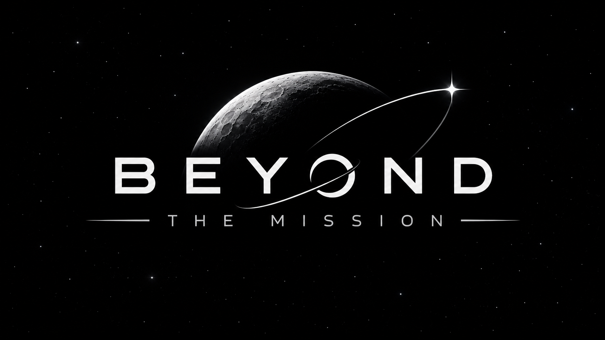

# 🚀 Beyond the Mission: Forensic Space Investigation
> **Abandoned but not Forgotten: Storytelling about NASA's Discarded Equipment on the Moon and Mars**

<p align="center">
  
</p>

Plataforma educativa e investigativa gamificada baseada no método científico e em dados e telemetria abertos da NASA. Em vez de um simples mapa estático, **Beyond the Mission** transforma estudantes e entusiastas em investigadores forenses espaciais, decifrando o destino de equipamentos esquecidos e separando fatos científicos comprovados de especulação e hipóteses.

---

## 🎯 Visão Geral do Projeto

A exploração espacial deixou marcos históricos na Lua e em Marte. Muitos desses artefatos foram considerados perdidos, outros encerraram seus ciclos após eventos climáticos extremos e alguns continuam operando de forma passiva após décadas.

**Beyond the Mission** resolve o *"problema do deserto cinza"* e a superficialidade dos catálogos convencionais através de:
- **Terminal Forense de Telemetria:** Acesso a gráficos reais (opacidade atmosférica, curvas de voltagem, logs de erro, últimas imagens corrompidas).
- **Mesa de Dedução Epistemológica:** Classificação de evidências entre *Fato Comprovado*, *Hipótese Provável*, *Dado Insuficiente / Inconclusivo* e *Mito / Ficção*.
- **Laboratórios de Simulação Física:** Experimentação interativa simplificada para validar as hipóteses (ex: relação poeira solar vs. bateria, medição laser LLR).
- **Relatório de Missão do Aluno / Modo Docente:** Geração de diagnósticos de raciocínio científico para uso em salas de aula (sessões de 15 minutos).

---

## 🔬 Os 3 Casos Piloto

1. **Morte em Combate — Rover Opportunity (*Marte, 2018*)**
   - **Cenário:** O rover silencioso após a maior tempestade de poeira global da década em Marte.
   - **Evidências:** Medições reais de opacidade *Tau*, curva de descarga da bateria e a última foto de transmissão parcial de 10 de junho de 2018.
   - **Simulação:** Painel fotovoltaico vs. intensidade de luz e acúmulo de poeira.

2. **Abandono Funcional — Retrorefletores Laser Apollo LLR (*Lua, 1969–Presente*)**
   - **Cenário:** Um instrumento sem fonte de alimentação, sem motor e abandonado há mais de meio século que ainda gera dados científicos diários.
   - **Evidências:** Dados do CDDIS Lunar Laser Ranging da NASA e medição do distanciamento orbital lunar (3,8 cm/ano).
   - **Simulação:** Alinhamento de pulso laser Terra-Lua e contagem de tempo de voo de fótons.

3. **Falha Crítica Oculta — Sonda Beagle 2 (*Marte, 2003–2015*)**
   - **Cenário:** Considerada perdida na reentrada marciana em 2003 até ser redescoberta intacta pela sonda MRO em 2015.
   - **Evidências:** Imagens em alta resolução da câmera HiRISE e diagramas do mecanismo de desdobramento de pétalas e antena RF.
   - **Simulação:** Inspeção visual com filtros de contraste e detecção de satélite orbital.

---

## 👥 Personas de Referência

- **Beatriz (16 anos — Investigadora Científica):** Busca compreender a construção do conhecimento científico; analisa relatórios primários, compara fotografias e defende hipóteses fundamentadas.
- **Mariana (Professora de Ciências):** Necessita de atividades dinâmicas de 15 minutos que desenvolvam pensamento crítico, distinguindo dados de fake news científicas e avaliando a participação da turma.

---

## 🛠️ Stack Tecnológica Recomendada

- **Frontend:** React / Vite, Tailwind CSS, TypeScript
- **Visualização 3D & Mapas:** Three.js / React Three Fiber / `react-globe.gl`
- **Componentes Interativos:** Lucide Icons, Framer Motion, Recharts / Chart.js para telemetria
- **Dados & APIs:** NASA Open Data (PDS, HiRISE, CDDIS LLR, Photojournal)

---

## 🚀 Como Executar o Projeto

```bash
# Clonar o repositório
git clone https://github.com/Beyond-The-Mission/beyond-the-mission-web.git
cd beyond-the-mission-web

# Instalar dependências (quando o scaffold web for adicionado)
npm install

# Iniciar servidor de desenvolvimento
npm run dev
```

---

## 📄 Licença
Distribuído sob a licença MIT. Consulte `LICENSE` para mais informações.
