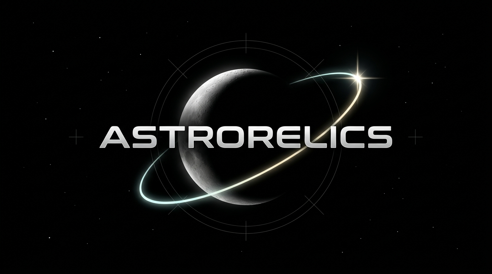

# 🚀 AstroRelics
> **Abandoned but not Forgotten: Exploração 3D interativa de artefatos históricos da NASA na Terra, na Lua, em Marte e no espaço profundo.**

<p align="center">
  
</p>

**AstroRelics** é uma experiência web interativa em 3D que transforma a história da exploração espacial em uma jornada visual navegável. Em vez de um catálogo estático, o usuário viaja pelo corredor orbital **Terra–Lua–Marte**, alternando entre astros com transições orbitais suaves e inspecionando em 3D cinco equipamentos históricos deixados — ou perdidos e redescobertos — pela NASA.

---

## 🌌 O que o Projeto Oferece

- **Navegação Orbital 3D & Salto Hiperespacial:** Viaje entre **Terra**, **Lua** e **Marte** com transições orbitais calculadas sem colisão, campo estelar, nebulosa, iluminação espacial e efeito visual de hiperespaço.
- **Inspeção Interativa de Artefatos Espaciais:** Selecione artefatos posicionados no espaço profundo ou ancorados nas coordenadas reais da superfície lunar e marciana para inspecionar seus modelos 3D em detalhe.
- **Painel de Contexto Científico e Histórico:** Para cada destino e artefato, o painel lateral exibe status da missão, localização/coordenadas, ficha técnica, descrição de engenharia, história da missão e importância científica.
- **Feedback Sonoro & Responsividade:** Efeitos sonoros espaciais sintetizados, HUD adaptativa para desktop, tablet e mobile, tela de carregamento com progresso de pré-carregamento dos modelos `.glb` e fallback automático caso WebGL não esteja disponível.

---

## 🪐 Corpos Celestes & Artefatos 3D

### Corpos Celestes
| Astro | Modelo 3D |
| --- | --- |
| **Terra** | `3d_models/Earth_1_12756.glb` |
| **Lua** | `3d_models/moon_small.glb` |
| **Marte** | `3d_models/24881_Mars_1_6792.glb` |

### 5 Artefatos Históricos da NASA
1. **J002E3 · Estágio S-IVB (Apollo 12)** — *Espaço Profundo (Corredor Terra–Lua)* (`3d_models/j002e3_s_ivb.glb`)
   - Terceiro estágio do Saturn V lançado em 1969, perdido por 33 anos e redescoberto em 2002 como um suposto asteroide até sua assinatura espectral de tinta TiO₂ revelar sua origem.
2. **Retrorefletor a Laser LRRR (Apollo 11, 14 e 15)** — *Lua · Mare Tranquillitatis* (`3d_models/apollo_lrrr.glb`)
   - Matriz óptica passiva de 100 prismas de quartzo instalada em 1969 que segue ativa há mais de 55 anos, permitindo medir o afastamento lunar de 3,8 cm/ano.
3. **Módulo Lunar "Snoopy" (Apollo 10)** — *Espaço Profundo (Órbita Heliocêntrica)* (`3d_models/apollo_lunar_module.glb`)
   - Estágio de subida do LM-4 que realizou o ensaio geral do pouso lunar em maio de 1969; única espaçonave tripulada a vagar intacta e desabitada em órbita solar.
4. **Rover Opportunity (MER-B)** — *Marte · Meridiani Planum* (`3d_models/opportunity_rover.glb`)
   - Projetado para 90 sóis, operou por quase 15 anos e percorreu 45,16 km em Marte antes de silenciar na tempestade de poeira global de 2018.
5. **Helicóptero Ingenuity (Mars 2020)** — *Marte · Cratera Jezero* (`3d_models/ingenuity_helicopter.glb`)
   - Primeira aeronave a realizar voo motorizado e controlado em outro planeta, completando 72 voos entre 2021 e 2024 (frente aos 5 planejados).

---

## 🛠️ Stack Tecnológica

- **Frontend:** React 18, TypeScript, Vite, Tailwind CSS
- **Gráficos 3D:** Three.js, React Three Fiber (`@react-three/fiber`), Drei (`@react-three/drei`)
- **Ícones & UI:** Lucide React (`lucide-react`) + ícones SVG customizados em `src/components/ui/ArtifactCartoonIcons.tsx`

---

## 📁 Estrutura Principal

```text
astrorelics/
├── 3d_models/                  # Modelos .glb dos astros e artefatos espaciais
├── public/                     # Assets estáticos (ex: logo-header.png)
└── src/
    ├── components/
    │   ├── scene/              # Canvas 3D, controles orbitais, transição hiperespacial, iluminação e atores
    │   └── ui/                 # HUD superior, painel de informações, ícones, loading e fallback WebGL
    ├── config/
    │   ├── celestialBodies.ts  # Configuração visual, escala e dados da Terra, Lua e Marte
    │   └── spaceArtifacts.ts   # Metadados, coordenadas, specs e modelos dos 5 artefatos
    ├── types/experience.ts     # Tipagens da experiência, astros e artefatos
    └── utils/
        ├── modelPreloader.ts   # Pré-carregamento e normalização de bounding box dos .glb
        ├── orbitalTransitionMath.ts # Cálculo de transição orbital sem colisão
        └── soundEffects.ts     # Efeitos sonoros da navegação e inspeção
```

> **Normalização automática de modelos:** O pré-carregador (`src/utils/modelPreloader.ts`) calcula a *Bounding Box* (`THREE.Box3`) de cada `.glb`, centraliza o pivô na origem `(0, 0, 0)` e normaliza o raio antes de aplicar as escalas configuradas em `src/config/celestialBodies.ts` e `src/config/spaceArtifacts.ts`.

---

## 🚀 Como Executar o Projeto

```bash
# Clonar o repositório
git clone https://github.com/AstroRelics/astrorelics-web.git
cd astrorelics-web

# Instalar dependências
npm install

# Iniciar servidor de desenvolvimento
npm run dev

# Gerar build de produção
npm run build
```

---

## 📄 Licença

Distribuído sob a licença MIT.
